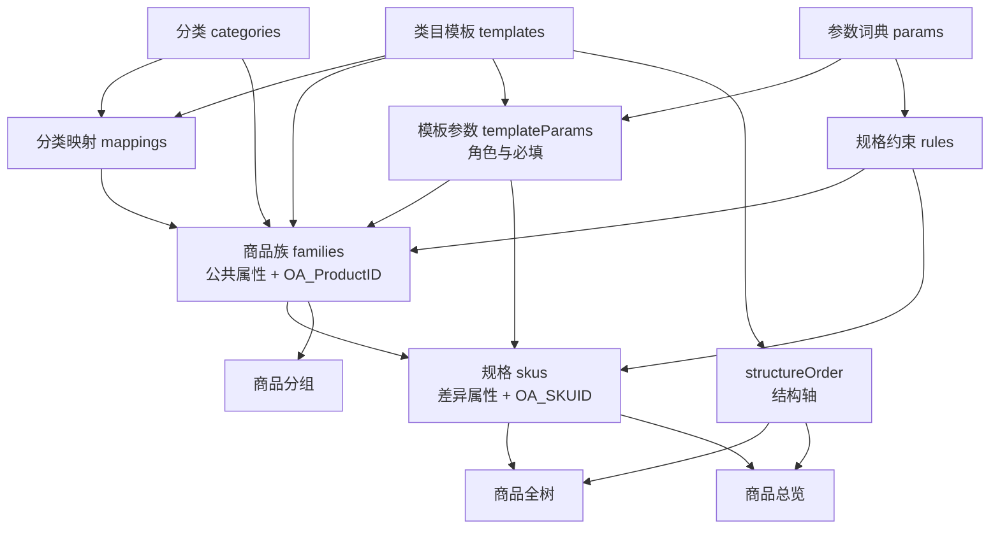

# 商品配置：对象、关联与层层闭环

本文给后续改这个演示工程的人用。它按当前代码写：`src/domain/types.ts`、`src/domain/logic.ts`、`src/domain/seed.ts`、`src/router/index.ts`。

数据只在浏览器 `localStorage`，键名 `iyge-v2-mock-db`，版本号 1。没有 HTTP 接口，也没有数据库索引。

线上旧系统（`http://223.243.25.99:8890`）里，一条商品就是一条可售记录，没有单独的商品族。那份说明以前放在篮球赛事仓库 `docs/iyge-商品配置闭环.md`。本演示已经把一款商品拆成「商品族 + 多条规格」。

对外仍用两个字段挂外部系统：

- `oaProductId`（页面文案 `OA_ProductID`）：挂在商品族上，业务上的 SPU 指针。
- `oaSkuId`（页面文案 `OA_SKUID`）：挂在规格上。

---

## 1. 页面

| 页面 | 路由 | 管什么 | 是否参与闭环 |
|---|---|---|---|
| 商品工作台 | `/` | 日常入口 | 是 |
| 商品列表 | `/products` | 按商品族看列表、筛选、列、视图 | 是 |
| 新增 / 编辑商品 | `/products/new`、`/products/:id` | 一款商品族和它的规格 | 是 |
| 商品配置检查 | `/check` | 必填、重复规格、规则是否命中 | 是 |
| 商品总览 | `/overview` | 按结构轴看哪些组合已经配了规格 | 是 |
| 分类管理 | `/categories` | 分类树 | 是 |
| 类目模板 | `/templates` | 模板树和结构轴顺序。仅管理员 | 是 |
| 参数词典 | `/params` | 参数名和枚举值 | 是 |
| 商品分组 | `/groups` | 筛选用的分组 | 否。不改变规格结构 |
| 规格约束 | `/rules` | 条件下还能选什么。仅管理员 | 是 |
| 分类映射 | `/mappings` | 分类和模板怎么对应。仅管理员 | 是 |
| 商品全树 | `/tree` | 按结构轴把已有规格铺成树 | 是 |
| 列配置与视图 | `/columns` | 转到商品列表的列面板 | 否 |
| 用户管理 | `/users` | 演示账号。仅管理员 | 否 |
| 反馈管理 | `/feedback` | 问题反馈 | 否 |
| 账号设置 | `/account` | 只校验密码表单，不保存 | 否 |

运营身份进不了类目模板、规格约束、分类映射、用户管理，会被送回工作台。

列表里的「品牌」是参数「品牌」的取值，不是单独的品牌表。

---

## 2. 对象

### 2.1 分类 `categories`

货架树。字段是 `id`、`name`、`parentId`、`sort`。分类自己不挂参数。

预设：

```
主机
  手机、平板、手表、电脑
配件
  保护及保护设备
    保护膜、保护壳
  充电类
```

### 2.2 类目模板 `templates`

参数方案的主人，也是一棵树。字段是 `id`、`name`、`parentId`、`enabled`、`structureOrder`。

`structureOrder` 是这个模板的结构轴，元素是参数 id。全树的层、总览的行和列都读这份顺序。

预设里「手机」模板的轴是：

```
容量 → 品牌 → 系列 → 型号 → 配置 → 内存 → 颜色 → 配件 → 国家 → 类型 → 网络版本
```

分类和模板是两棵树。名字可以一样，id 不能混用。它们只通过「分类映射」和「商品族上的两个外键」相遇。

### 2.3 参数词典 `params`

一份词典，可被多个模板共用。

| 字段 | 含义 |
|---|---|
| `id` | 约束规则用 id |
| `name` | 商品属性用名字做键 |
| `values` | 允许的取值 |
| `valueGroups` | 把取值再分组，方便表单筛选 |
| `participateInStructure` | 为 true 时才进入结构轴 |

预设参数都参与结构。给「颜色」加一个新值，所有挂了颜色的模板都能看到。

### 2.4 模板参数 `templateParams`

参数挂到模板上的那一层。字段是 `templateId`、`paramId`、`role`、`required`。

`role` 只有两种：

- `common`：写在商品族上，这一款的所有规格共用。
- `variant`：写在每条规格上，用来区分 SKU。

角色和结构轴不是同一件事。手机模板里，「品牌 / 系列 / 型号」是公共参数，「容量」排在结构轴第 0 层，但角色是规格参数。树的第一层仍然是容量。

### 2.5 分类映射 `mappings`

一条映射是 `{ templateId, categoryId }`。选分类时用来带出模板，选模板时用来带出分类。查找取第一条匹配。

预设把手机、平板、电脑、手表、保护膜各自对上同名分类。

### 2.6 规格约束 `rules`

回答：前面已经选了这些值，目标参数还能选哪些。它不决定树有几层。

| 字段 | 含义 |
|---|---|
| `templateId` | 只在这个模板里生效 |
| `targetParamId` | 被限制的参数 |
| `sourceParamIds` | 条件参数 |
| `conditions` | `{ 参数 id: 取值 }`，全部相等才命中 |
| `options` | 命中后允许的值 |
| `enabled` | 关掉后不参与计算 |
| `legacy` | 旧系统残留。计算时直接跳过 |

判定在 `constraintOf`：

1. 这个模板、这个目标参数没有任何现行规则：状态 `none`，可选完整词典。
2. 有规则，但条件参数还没填完：状态 `none`，仍用完整词典。
3. 条件都填了，但没有一条规则对上：状态 `uncovered`，仍允许词典值，检查页给警告。
4. 命中且 `options` 有值：状态 `hit`，只能选这些值。
5. 命中但 `options` 为空：状态 `empty`，没有合法选项。

手机预设有一条链：

```
品牌 Apple
  → 系列 iPhone 17、iPhone 16
    → 型号 iPhone 17、iPhone 17 Pro
      → 容量 128G、256G
        → 仅当容量是 128G 时，颜色收成蓝 / 白 / 橙
```

颜色规则不管 256G。预设里的蓝手机、白手机都是 256G，所以颜色是「尚未配置限制」，不是「规则允许了 256G」。

另有一条 `legacy: true` 的旧规则，目标参数 id 已不在词典里，只作参考。

已经保存的规格不会因为改规则被自动改写。检查在读取时重算。

### 2.7 商品族 `families` 和规格 `skus`

商品族是一款货。规格是这款货下的一条可售组合。

商品族：`name`、`templateId`、`categoryId`、`oaProductId`、`commonAttrs`、`productGroupIds`、`lifecycle`（`draft` / `ready`）、`origin`（`sample` 预设演示，`created` 本地新建）。

规格：`familyId`、`code`、`oaSkuId`、`status`（`on_sale` / `off_sale` / `draft`）、`variantAttrs`、`projectedAttrs`。

`commonAttrs` 和 `variantAttrs` 的键都是参数名。`projectedAttrs` 是两者合并后的结果，空值不保留。全树和总览读的是这份合并结果。

同一商品族下，规格参数的取值组合不能重复。

预设里的 iPhone 17：

- 商品族「Apple iPhone 17」：分类手机，模板手机，公共属性是品牌 Apple、系列 iPhone 17、型号 iPhone 17。`oaProductId` 为空。
- 规格「蓝色」：容量 256G，颜色蓝色。配件和网络版本为空。在售。
- 规格「白色」：容量 256G，颜色白色，配件简版，网络版本 `A1533（电信）`。在售。

### 2.8 商品分组 `productGroups`

另一棵用来筛选的树。不进入结构轴，也不进入总览矩阵。一个商品族可以挂多个分组。

---

## 3. 它们怎么连



写代码时守住这些：

1. 分类不直接指向模板。对应关系在 `mappings`，商品族上再各存一个 id。
2. 约束用参数 id。属性用参数名。先做 id 和 name 的对照。
3. 结构轴只收 `structureOrder` 里、且 `participateInStructure` 为真的参数。
4. 公共 / 规格角色决定值写在族上还是规格上，不决定树的层序。
5. 全树和总览只投影已经存在的规格，不展开词典的笛卡尔积。
6. 没有命中规则时允许词典值。`uncovered` 是警告，不是禁止保存。

---

## 4. 层层闭环

### 第 1 层：两棵树和一条映射

分类回答货放在哪个货架。模板回答用哪套规格描述。映射把二者配上。商品保存时分类和模板都要有。

### 第 2 层：参数、角色、结构顺序

在参数词典里定义名称和枚举。在模板上标明公共还是规格、是否必填，并排好 `structureOrder`。

手机现在有 11 个轴，最后一轴是网络版本。手表的轴不同，保护膜只有品牌、颜色、配件。

### 第 3 层：约束收成合法路径

词表本身允许「huawei + iPhone 17」。约束负责说哪些组合不合法。填表时用已经选中的参数 id 去问 `constraintOf`，不要求按树的层序填。

### 第 4 层：商品族加规格

一款商品族钉住分类、模板、公共属性和 `oaProductId`。每条规格钉住差异属性、状态和 `oaSkuId`。

检查 `inspectFamily` 会报：名称为空、分类为空、必填未填、规格条数为 0、规格组合重复、取值不在命中规则里、条件尚未被规则覆盖。

### 第 5 层：全树和总览读回去

全树按结构轴往下长。没填的参数仍占一层，标签是「（空）」。紧凑模式会跳过空值。叶子带 `skuId` 和 `familyId`。

总览默认把最后一个结构参数当列，前面的轴当行。传入别的列参数时，`v2` 为真。格子状态：

| 状态 | 含义 |
|---|---|
| `missing` | 这一行列组合没有规格 |
| `empty-axis` | 规格在，但列参数没填 |
| `incomplete` | 有必填缺失 |
| `illegal` | 取值不在允许范围 |
| `ok` | 已符合配置 |

手机模板的列默认是「网络版本」。蓝色那条没填网络版本，格子是「商品存在，此规格未填」。白色那条填了 `A1533（电信）`，这一列才能点亮。

### 第 6 层：列表把圈子转回去

商品列表按关键词、分类、品牌、状态、模板、商品分组和属性过滤。列的显示存在 `columns`，筛选还可以存成 `listViews`。这两样只影响怎么看。

改参数顺序，全树和总览一起变。改约束，下次检查收紧或放宽，已存规格保持原值。删分组时，要从商品族的 `productGroupIds` 里摘掉。删参数时，要看规则是否还指着这个 id。

---

## 5. 改代码时的边界

### 新增商品的模型选择器已验收，默认不要改

商品模型设计器允许 `ATTRIBUTE -> ATTRIBUTE`。新增商品选择器必须严格按照当前节点路径展开。

不要把同级 `ATTRIBUTE` 自动提升到当前页面。只有某个 `ATTRIBUTE` 是当前节点的直接子节点、并且作为当前选择项出现时，它才可以作为一个选项展示。

```
品牌(attribute)
  children:
    Apple(value)
    型号(attribute)

正确：
  品牌下拉: Apple、型号
  选择 Apple: 进入 Apple 的 children
  选择 型号: 进入型号节点

错误：
  品牌一行
  型号一行
  同时展示
```

解析只看 `parentId`、`nodeType`、`role`，不要按属性名写死。`COMMON` 单选，`VARIANT` 多选。选中属性值后只进入该值的子节点。规格属性的笛卡尔积在 `generateSkuFromModel`，不要改回只生成一条 SKU。

未明确要求修改选择器或 SKU 组合时，保持这些实现：

- `src/components/ProductModelSelector.vue`
- `src/domain/logic.ts` 中的 `visibleAttributeGroups`、`modelFormRows`、`chooseModelNode`、`truncateModelPath`、`modelSelectionTrail`、`collectModelSelections`
- `generateSkuFromModel`

不要为了选择器去改设计器的连线，也不要改 `productSpecNodes`、`specModelVersions`、`nodesSnapshot`、`families` / `skus` 的数据结构。

当前选择器读的是浏览器里的 mock 快照。以后改成接口数据时再另说，现在不要为接接口去改这段交互。

- 商品族是公共属性和 `oaProductId` 的落点。规格是差异属性和 `oaSkuId` 的落点。不要再折回「一条商品一行」的旧接口形状，除非明确要对接线上 `/api/v1`。
- 分类和模板继续分成两棵树。同名不是同一个 id。
- 全树和总览以模板的 `structureOrder` 为准，不以参数数组的存放顺序为准。
- 总览不是全排列。最后一个结构参数默认是列；该值为空的规格会占一行，格子保持未填写。
- `uncovered` 表示没有规则罩住当前组合，表单仍给出词典，检查页给警告。
- `legacy: true` 的规则不参与 `constraintOf`。
- 预设数据标了 `origin: sample`。重置会回到 `createSeed()`，不是线上导出。
